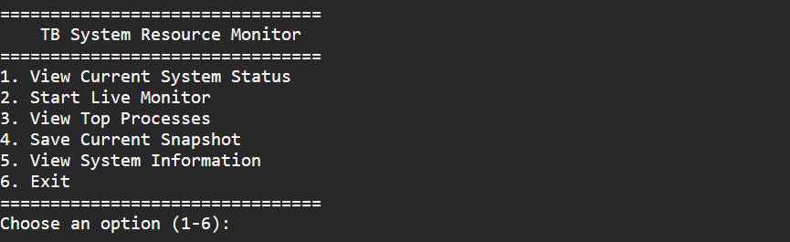
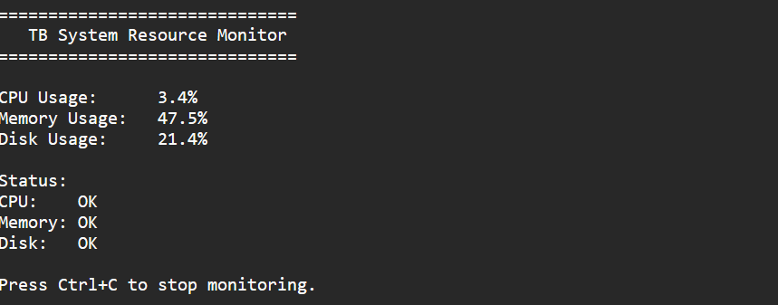

# TB System Resource Monitor

## What It Does
[Write 2-4 sentences in your own words: what the program shows, what it warns about, and what it saves.]

## Features
- [One bullet per thing it can do. Start from the 6 menu options and add details like warnings and CSV logging.]

## Technologies
- Python
- psutil
- Standard library: [list the modules you imported: os, platform, socket, time, csv, datetime]

## Project Structure
```text
tb-system-resource-monitor/
├── main.py            <- [your one-line description]
├── monitor.py         <- [your one-line description]
├── logger.py          <- [your one-line description]
├── logs/
│   └── .gitkeep       <- [your one-line description]
├── .gitignore         <- [your one-line description]
├── README.md          <- [your one-line description]
└── requirements.txt   <- [your one-line description]
```

## Installation
```bash
git clone https://github.com/ROnescar/tb-system-resource-monitor.git
cd tb-system-resource-monitor
python -m pip install -r requirements.txt
```

## How to Run
```bash
python main.py
```

## Menu Options
1. **View Current System Status**: [what it does]
2. **Start Live Monitor**: [what it does]
3. **View Top Processes**: [what it does]
4. **Save Current Snapshot**: [what it does]
5. **View System Information**: [what it does]
6. **Exit**: [what it does]

## Screenshots
**Main menu**



**Live monitor**



## Known Limitations
- Measuring CPU usage takes about 1 second, so the status screen and snapshots pause briefly before showing results.
- Some system processes can't be read without administrator access, so the top processes list skips them and may not include every program that's using memory.
- The program only checks the main disk (`C:\` on Windows), not any other drives.
- The live monitor refreshes about every 3 seconds, because the 2-second wait is added to the 1-second CPU measurement.
- The warning limits (80% CPU, 80% memory, 90% disk) are fixed in the code. A user has to edit `monitor.py` to change them.
- Memory "used" is calculated differently on macOS, so the numbers may not match what other tools show.
- I have mainly tested it on Windows, so it may behave differently on other operating systems.


## Optional Features I Added
None yet.

## What I Learned
Building this project taught me how to split a program into separate files, with `main.py` for the menu, `monitor.py` for collecting data, and `logger.py` for saving it. I practiced writing functions, using dictionaries to group related information, and using lists and loops to work through the process list. I learned how to install and use a library (`psutil`) and how to read its documentation to get CPU, memory, disk and process information.

I also learned how to handle errors with `try/except`, such as catching `Ctrl+C` in the live monitor, skipping processes that can't be read, and showing a friendly message when a file can't be saved. Writing to a CSV file showed me how to open a file in append mode and why the header should only be written once. Finally, I practiced using Git and GitHub: cloning a repository, committing in small steps, pushing, and fixing sign-in problems. I'm more comfortable with the terminal than I was before.